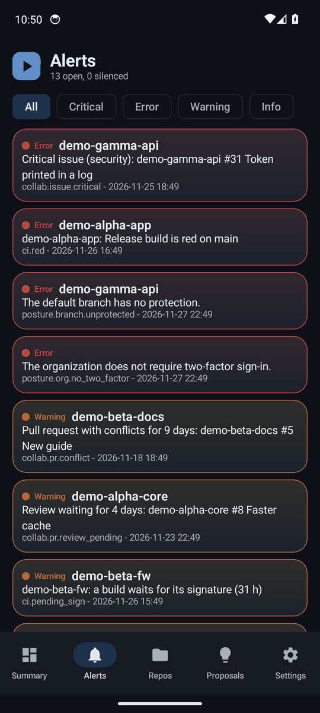
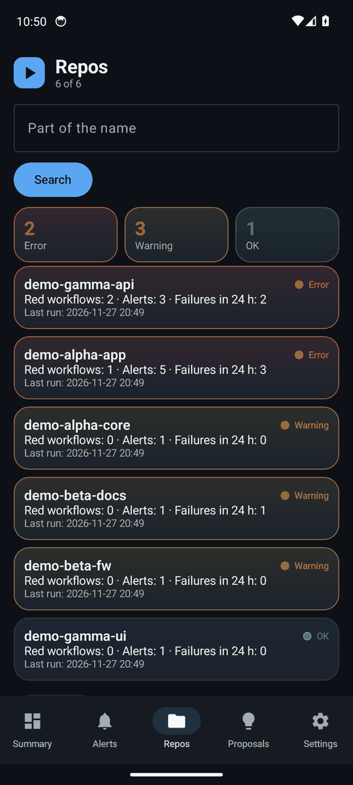

<p align="center">
  
</p>

# 🛠️ TOOLS-GITHUB-ACTIONS-MONITOR-ANDROID

<p align="center"><a href="README.md">🇺🇸 English</a> | <a href="README_spa.md">🇪🇸 Español</a> | <a href="README_fra.md">🇫🇷 Français</a> | <a href="README_ita.md">🇮🇹 Italiano</a> | 🇩🇪 <b>Deutsch</b> | <a href="README_zho.md">🇨🇳 中文</a> | <a href="README_jpn.md">🇯🇵 日本語</a> | <a href="README_por.md">🇵🇹 Português</a></p>

### Native Android-App für GitHub Actions Monitor: Übersicht, Warnungen, Repositories und die Vorschläge seiner KI auf dem Telefon, nur lesend.

<p align="center">
  
  
  
  
  
  
</p>

---

**Vorabversion: nicht auf einem echten Telefon getestet.** Der Client wird in GitHub Actions gegen Demo-Monitore (erfundene Daten) geprüft und die Ansichten werden in einem Emulator fotografiert, aber die App war noch nie auf einem Telefon zu sehen und hat noch mit keinem Monitor im Alltag gesprochen. Sie sendet keine Push-Benachrichtigungen: Der Monitor hat noch keinen Push-Dienst.

---

> **Stand von Sicherheit und IT-Sicherheit:** diese App liest einen Monitor; außer An- und Abmelden ändert sie nichts, und Vorschläge werden nur auf dem Rechner des Monitors angenommen oder abgelehnt. Sie ist kein Sicherheitssystem (Safety) für irgendeine Maschine.

## 📋 Auf einen Blick

| | |
|---|---|
| Version | `0.1.1` |
| Reifegrad | Gerüst |
| Tests | 75 |
| Technologie-Stack | Kotlin, Jetpack Compose (Android 8.0+) |
| Auf echter Hardware | Nicht auf einem echten Telefon getestet (vorläufig) |

**Springe zu:** [Überblick](#-überblick) · [Architektur](#-architektur) · [Schnellstart](#-schnellstart) · [Tests](#-tests) · [Struktur des Repositorys](#-struktur-des-repositorys) · [Verwandte Projekte](#-verwandte-projekte)

## 🚦 Projektstatus

Jede Zeile ist ein Teil dieses Repositorys, und die Ampel sagt, wie weit er heute ist. Sie beruht auf dem, was das Repository zeigen kann (Tests, Builds, Läufe), nicht auf dem, was geplant ist.

🟢 Fertig und überprüft · 🟡 Funktioniert, mit bekannten Grenzen · 🟠 Teilweise fertig oder noch nicht überprüft · 🔴 Nicht gemacht oder funktioniert nicht

| Bereich | Stand | Was das hier bedeutet |
|---|---|---|
| Repository-Prüfungen | 🟡 | Die Repository-Prüfung, die Bildprüfung, die leichten Prüfungen der App (acht Sprachen, Ressourcen, Geheimnisse) und ihre Tests laufen im CI. |
| Regeln und Monitor-Client | 🟡 | 64 JVM-Unit-Tests sind geschrieben, darunter der Client gegen aufgezeichnete Antworten eines Demo-Monitors; die CI führt sie mit Gradle aus, prüft ihre Anzahl und lässt den Client gegen laufende Demo-Monitore arbeiten. |
| Ansichten und Keystore | 🟠 | In einem Emulator gegen einen Demo-Monitor fotografiert; nie auf einem Telefon ausgeführt. |
| Push-Benachrichtigungen | 🔴 | Der Monitor hat keinen Push-Dienst: Die App bietet keinen Schalter und fragt keine Berechtigung ab. |
| Routen des Monitors | 🟡 | Gegen den Demo-Monitor des in `.github/workflows/ci.yml` festgelegten Commits geprüft; nicht gegen einen Monitor im Alltag. |

## 🎯 Überblick

* **Der Monitor in der Tasche:** Übersicht, Warnungen, Repositories und Vorschläge eines GitHub Actions Monitor im Netzwerkmodus.
* **Anmeldung so, wie der Monitor sie verlangt:** das Zugriffstoken des Netzwerkmodus und, wenn der Monitor Benutzer hat, die Sitzung einer Person.
* **Nur lesend:** Vorschläge zeigen den genauen Befehl und seinen Hash; zugestimmt wird auf dem Rechner des Monitors.
* **Nichts Geheimes im Repository:** Die Token werden mit einem Schlüssel des Android Keystore versiegelt; hier gibt es keine Firebase-Datei, keinen Schlüssel und keinen Keystore.

## 🧩 Rolle in EH3D

TOOLS-GITHUB-ACTIONS-MONITOR-ANDROID ist die Android-App des GitHub Actions Monitors (TOOLS-GITHUB-ACTIONS-MONITOR). Sie ist ein Client: Sie berechnet keine eigenen Regeln zu Warnungen oder Vorschlägen; der Monitor entscheidet, was kritisch ist und was ein Vorschlag ist, und die App zeigt es an und fragt eine Person.

## 🏛️ Architektur

<p align="center">
  
</p>

Wie die Teile dieses Repositorys zusammenpassen: wer es nutzt, was es enthält und wovon es abhängt. Das Bild wird aus `docs/architecture.json` gezeichnet und gegen den Code geprüft.

## ✨ Funktionen

* Fünf Ansichten: Übersicht, Warnungen (Filter nach Stufe), Repositories (nach Risiko sortiert, Suche nach Namen), Vorschläge (offene oder alle, mit Details) und Einstellungen.
* An- und Abmelden, wenn der Monitor im Teammodus arbeitet; jede Ablehnung des Monitors hat ihre eigene Meldung.
* Links `ghamon://proposal/<id>?hash=<hex>` öffnen einen Vorschlag und warnen, wenn sich sein Inhalt seit dem Erstellen des Links geändert hat.
* Acht Sprachen, die der Sprache des Telefons folgen: Englisch, Spanisch, Deutsch, Französisch, Italienisch, Japanisch, Chinesisch und europäisches Portugiesisch.

Die Bilder zeigen die App in einem Emulator gegen einen Demo-Monitor mit erfundenen Daten:

<table><tr><td align="center"><br>Anmeldung</td><td align="center"><br>Übersicht</td><td align="center"><br>Warnungen</td><td align="center"><br>Repositories</td><td align="center"><br>Vorschläge</td></tr></table>

## 🔒 Sicherheit und Schutz

* Zugriffstoken und Sitzung werden mit AES-GCM unter einem Schlüssel aus dem Android Keystore versiegelt, nie in ein Protokoll oder einen Fehlertext geschrieben und nur an die eingegebene Adresse gesendet; beim Ändern der Adresse werden sie verworfen, Weiterleitungen werden nie befolgt.
* Das Passwort wird einmal zum Anmelden gesendet und nicht gespeichert.
* Unverschlüsseltes `http://` wird nur für localhost, `.local`-Namen und private IPv4-Adressen akzeptiert; jeder andere Host braucht `https://`, geprüft nur gegen die Zertifizierungsstellen des Systems.
* Ein Link öffnet nur einen Vorschlag; vom Telefon aus wird nichts genehmigt oder ausgeführt.
* Die App-Daten sind von Sicherungen ausgenommen, und `python -I tools/check_app.py` schlägt fehl, wenn eine Firebase-Datei, ein Keystore oder ein Schlüssel im Baum liegt.

## 🔌 Schnittstellen

* Lesend: `GET /api/auth/me`, `/api/health`, `/api/alerts`, `/api/team/health`, `/api/ai/actions` und `/api/accounts` (nur bei mehreren Konten).
* An- und Abmelden: `POST /api/auth/login` (`client: "api"`) und `POST /api/auth/logout`.
* Kopfzeilen: `X-Monitor-Access` mit dem Zugriffstoken und im Teammodus `Authorization: Bearer` mit der Sitzung.
* Link: `ghamon://proposal/<id>?hash=<64 Hexadezimalzeichen>`.

## ⚙️ Konfiguration

Alle einstellbaren Werte stehen in `app/src/main/assets/app_config.json`: die Pfade, die Zeitlimits, die Größenbegrenzung, die Push-Regel und das Link-Schema. Adresse, Zugriffstoken und Benutzer geben Sie in den Einstellungen der App ein; sie bleiben auf dem Telefon.

Am Monitor muss `listen.network` eingeschaltet sein; ein Name (keine Adresse), unter dem er erreicht wird, gehört in `listen.allowed_hosts`; setzen Sie das Zugriffstoken in `MONITOR_ACCESS_TOKEN`, damit es nicht bei jedem Start wechselt; mit Benutzern (Teammodus) schalten Sie auch `auth.allow_bearer` ein.

## 🚀 Schnellstart

Zum Bauen brauchst du JDK 21 und das Android SDK (Android Studio bringt beides mit); die leichten Prüfungen brauchen nur Python 3.10 oder neuer. Öffne die App, gehe zu Einstellungen, gib die Adresse deines Monitors und seinen Token ein und speichere.

```bash
./gradlew testDebugUnitTest lintDebug
python -I tools/check_app.py
python -I tools/ci_validate.py
python -I tools/make_architecture.py --check
python -I tools/make_structure.py --check --readmes
python -I -m unittest discover -s tools -p "test_*.py"
```

## 🧪 Tests

64 Unit-Tests laufen ohne Telefon auf der JVM (`./gradlew testDebugUnitTest`): der Client gegen aufgezeichnete Antworten eines Demo-Monitors, seine Ablehnungen, die Links, die Einstellungen und die Push-Regel. Fünf davon sprechen mit laufenden Demo-Monitoren und werden übersprungen, wenn der CI-Job "contract" sie nicht startet. 11 Python-Tests decken das Repository und die leichten Prüfungen der App ab. Nichts davon lief auf einem Telefon.

## 🏗️ Build und Veröffentlichung

Die Version steht in `VERSION`, in `electro-hobby-3d.project.json` und in `app/build.gradle.kts` (der Build bricht ab, wenn sie sich unterscheiden), und jede Version hat ihren Eintrag im [CHANGELOG.md](CHANGELOG.md). Der Release-Build wird mit R8 verkleinert und danach mit dem eigenen Schlüssel des Maintainers signiert, der außerhalb des Repositorys liegt. Die erste Version ist vorläufig: Sie wurde nicht auf einem echten Telefon getestet. GitHub Actions baut die APK (der Workflow "APK build (manual)", von Hand gestartet, ohne Signaturschlüssel) und der Maintainer signiert sie mit seinem eigenen Schlüssel und veröffentlicht sie zusammen mit `SHA256SUMS` als Vorabversion. **Installieren:** Lade `TOOLS-GITHUB-ACTIONS-MONITOR-ANDROID-release.apk` aus dem neuesten Release auf der Releases-Seite herunter, prüfe sie mit `sha256sum -c SHA256SUMS`, erlaube in den Einstellungen des Telefons die Installation aus dieser Quelle (Android 8.0 oder neuer) und öffne die Datei, oder führe `adb install TOOLS-GITHUB-ACTIONS-MONITOR-ANDROID-release.apk` aus. **Aktualisieren:** Installiere die neuere APK über die alte; die Einstellungen bleiben erhalten, weil die Signatur gleich und der Versionscode höher ist, und das Token bleibt im Keystore versiegelt. Lehnt Android das Update ab, ist die Signatur nicht dieselbe: Entferne zuerst die alte App (Token und Einstellungen gehen verloren).

## 📂 Struktur des Repositorys

<p align="center">
  
</p>

<details>
<summary>Textversion des Baums</summary>

```text
MONITOR-ANDROID/
├── app/
│   ├── build.gradle.kts proguard-rules.pro                der Build und die Verkleinerungsregeln
│   ├── src/main/AndroidManifest.xml                       Berechtigungen, Aktivität, Link ghamon://
│   ├── src/main/assets/app_config.json                    Pfade, Zeitlimits, Größenlimit, Push-Regel
│   ├── src/main/res/                                      die Texte in acht Sprachen, Symbole und Themes
│   ├── src/main/java/es/electrohobby3d/ghamonitor/core/   auf der JVM getestete Regeln
│   ├── src/main/java/es/electrohobby3d/ghamonitor/        Bildschirme, View-Model, Theme, Keystore
│   ├── src/test/java/es/electrohobby3d/ghamonitor/core/   die Unit-Tests auf der JVM
│   ├── src/test/resources/contract/                       aufgezeichnete Antworten eines Demo-Monitors
│   └── src/androidTest/                                   die Bildschirmfotos im Emulator
├── tools/
│   ├── ci_validate.py                                     Manifest, Versionen, README-Parität
│   ├── check_app.py                                       Sprachen, Ressourcen, Konfiguration und Geheimnisse der App
│   ├── make_architecture.py make_structure.py             zeichnen die beiden Bilder des README
│   └── contract/                                          Demo-Monitore und Aufzeichnung der Antworten
├── docs/                                                  die Quellen der beiden Bilder
├── gradle/                                                die Dateien des Gradle-Wrappers
├── gradlew                                                der Gradle-Wrapper
├── gradlew.bat                                            der Gradle-Wrapper
├── build.gradle.kts                                       die Plugins und der Name des Builds
├── settings.gradle.kts                                    die Plugins und der Name des Builds
├── gradle.properties                                      der Speicher des Builds
├── images/                                                Banner und die beiden Bilder
├── .github/                                               CI-Workflows und Vorlagen
├── VERSION                                                die Version des Repositorys
├── electro-hobby-3d.project.json                          das Manifest des Projekts
├── CHANGELOG.md                                           was sich in jeder Version geändert hat
├── SECURITY.md SUPPORT.md                                 Schwachstellen melden und Fragen stellen
└── CONTRIBUTING.md CODE_OF_CONDUCT.md LICENSE             Mitwirken, Verhaltenskodex und Lizenz
```

</details>

## 🗺️ Roadmap und bekannte Grenzen

**Heute bekannte Grenzen**

* Vorabversion: Die App lief noch auf keinem Telefon.
* Die Lite-Ausgabe des Monitors hat keine Warnungen, Repositories oder Vorschläge; die App kann das nur sagen.
* Kein Push-Dienst: Der Monitor sendet noch keine Push-Nachrichten.
* Das Koppeln über den QR-Code des Monitors wird nicht unterstützt; das Zugriffstoken wird eingetippt.

**Als Nächstes**

* Auf einem Telefon gegen einen echten Monitor erproben, danach Koppeln per QR-Code und Push, sobald der Monitor es anbietet.

## 🌍 Sprachen

README und Texte gibt es auf Englisch, Spanisch, Französisch, Italienisch, Deutsch, Chinesisch, Japanisch und europäischem Portugiesisch.

## 🔗 Verwandte Projekte

* [TOOLS-GITHUB-ACTIONS-MONITOR](https://github.com/JuanenRac/TOOLS-GITHUB-ACTIONS-MONITOR): der Monitor, dessen Client diese App ist
* [EH3D-DOCS](https://github.com/JuanenRac/EH3D-DOCS): die Konventionen und die gemeinsamen Prüfungen

## 📚 Dokumentation

* [Die Konventionen der Suite](https://github.com/JuanenRac/EH3D-DOCS/blob/main/docs/CONVENTIONS.md)
* [Änderungsprotokoll](CHANGELOG.md)

## 🤝 Mitwirken und Community

* Führe vor einer Pull Request `python -I tools/ci_validate.py` und `python -I tools/check_app.py` aus; der Gradle-Build, die Tests und das Lint laufen im CI. Siehe [CONTRIBUTING.md](CONTRIBUTING.md) und den [Verhaltenskodex](CODE_OF_CONDUCT.md).
* Das README gibt es in acht Sprachen: Eine Textänderung wird in allen acht Dateien gemacht, und die beiden Bilder werden aus `docs/architecture.json` und `docs/structure.json` mit `tools/make_architecture.py` und `tools/make_structure.py` gezeichnet.
* Melde eine Schwachstelle privat: [SECURITY.md](SECURITY.md). Fragen, Ideen und Meldungen: electrohobby3d@gmail.com ([SUPPORT.md](SUPPORT.md)).

## 👤 AUTOR

**JuanenRac (Electro Hobby 3D)** · electrohobby3d@gmail.com

## 📜 LIZENZ

Software: GPL-3.0-or-later. Siehe [LICENSE](LICENSE). Die Hardware-Entwürfe der Suite verwenden die CERN OHL-S.
