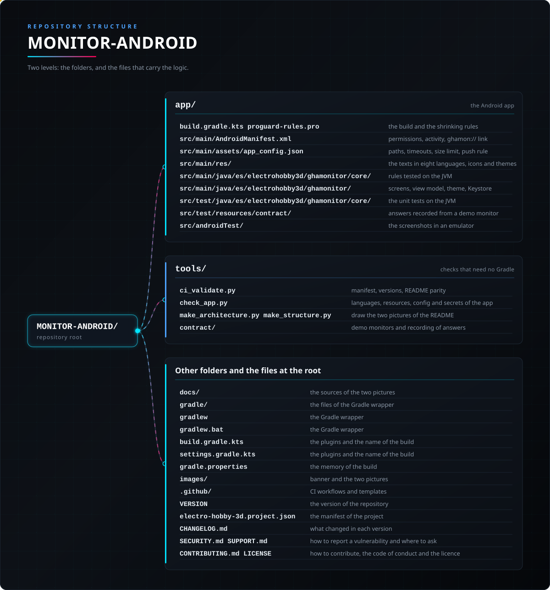

<p align="center">
  
</p>

# 🛠️ TOOLS-GITHUB-ACTIONS-MONITOR-ANDROID

<p align="center"><a href="README.md">🇺🇸 English</a> | <a href="README_spa.md">🇪🇸 Español</a> | 🇫🇷 <b>Français</b> | <a href="README_ita.md">🇮🇹 Italiano</a> | <a href="README_deu.md">🇩🇪 Deutsch</a> | <a href="README_zho.md">🇨🇳 中文</a> | <a href="README_jpn.md">🇯🇵 日本語</a> | <a href="README_por.md">🇵🇹 Português</a></p>

### Application Android native de GitHub Actions Monitor : résumé, alertes, dépôts et propositions sur le téléphone, avec des notifications push uniquement critiques, désactivées par défaut.

<p align="center">
  
  
  
  
  
  
</p>

---

**Préliminaire : non testée sur un vrai téléphone.** Les règles et le client de l'API sont couverts par des tests unitaires exécutés sur la JVM dans la CI et l'APK de la version est compilé par GitHub Actions, mais l'application n'a jamais été affichée sur un téléphone ni n'a jamais parlé à un vrai moniteur. Les notifications push sont désactivées par défaut et aucun service push n'est connecté.

---

> **État de la sûreté et de la sécurité :** cette application lit un moniteur et peut approuver ou rejeter des propositions d'action qui peuvent relancer des workflows ou commenter sur GitHub. Une approbation est liée au contenu exact affiché, une autre personne doit approuver (le moniteur l'impose) et un lien n'approuve jamais rien de lui-même. Ce n'est pas un système de sécurité (safety) pour une machine.

## 📋 En un coup d'œil

| | |
|---|---|
| Version | `0.1.0` |
| Maturité | Échafaudage |
| Tests | 80 |
| Pile technique | Kotlin, Jetpack Compose (Android 8.0+) |
| Sur du matériel réel | Non testée sur un vrai téléphone (préliminaire) |

**Aller à  :** [Présentation](#-présentation) · [Architecture](#-architecture) · [Démarrage rapide](#-démarrage-rapide) · [Tests](#-tests) · [Structure du dépôt](#-structure-du-dépôt) · [Projets liés](#-projets-liés)

## 🚦 État du projet

Chaque ligne est une partie de ce dépôt et le feu dit où elle en est aujourd'hui. Elle est écrite d'après ce que le dépôt peut montrer (tests, compilations, exécutions), pas d'après ce qui est prévu.

🟢 Fait et vérifié · 🟡 Fonctionne, avec des limites connues · 🟠 À moitié fait ou pas encore vérifié · 🔴 Pas fait ou ne fonctionne pas

| Domaine | État | Ce que cela veut dire ici |
|---|---|---|
| Contrôles du dépôt | 🟡 | Le contrôle du dépôt, celui des images, les contrôles légers de l'application (huit langues, ressources, secrets) et leurs tests s'exécutent dans la CI. |
| Règles et client de l'API | 🟠 | 69 tests unitaires JVM sont écrits (approbation, liens, filtre push, réglages, le client face à un réseau simulé) ; la CI les exécute avec Gradle et vérifie combien ont tourné. |
| Écrans et Keystore | 🔴 | Écrits et compilés en CI, mais jamais affichés sur un écran et jamais exécutés sur un téléphone. |
| Notifications push | 🟠 | Uniquement critiques et désactivées par défaut ; la partie Firebase est une implémentation nulle tant qu'aucun projet Google n'existe. |
| Routes du moniteur | 🟠 | Les routes de lecture suivent le contrat de l'API v1 du moniteur ; les routes de propositions et d'appareils appelées par l'application ne sont pas encore dans le moniteur. |

## 🎯 Présentation

* **Le moniteur dans la poche :** le résumé, les alertes, les dépôts et les propositions d'un GitHub Actions Monitor, lus avec un jeton bearer via son API v1.
* **Décisions à quatre yeux :** approuvez ou rejetez une proposition après avoir vu son contenu exact ; l'approbation est liée à l'empreinte de ce contenu et le moniteur la refuse si la même personne a créé la proposition.
* **Silencieuse par défaut :** les notifications push sont désactivées, uniquement critiques, une fois par alerte, avec un titre court et rien d'autre.
* **Rien de secret dans le dépôt :** le jeton est chiffré avec une clé du Keystore Android ; il n'y a ici ni fichier Firebase, ni clé, ni keystore.

## 🧩 Rôle dans EH3D

TOOLS-GITHUB-ACTIONS-MONITOR-ANDROID est l'application Android de GitHub Actions Monitor (TOOLS-GITHUB-ACTIONS-MONITOR). C'est un client : elle ne calcule aucune règle propre sur les alertes ou les propositions ; le moniteur décide ce qui est critique et ce qu'est une proposition, et l'application l'affiche et interroge une personne.

## 🏛️ Architecture

<p align="center">
  
</p>

Comment les parties de ce dépôt s'articulent : qui l'utilise, ce qu'il contient et de quoi il dépend. L'image est dessinée à partir de `docs/architecture.json` et vérifiée par rapport au code.

## ✨ Fonctionnalités

* Cinq écrans : résumé, alertes (filtre par niveau, pagination par curseurs), dépôts (ceux qui ont des alertes et une recherche de n'importe quel dépôt), propositions (en attente ou toutes, avec le détail) et réglages.
* Approuver ou rejeter une proposition après une confirmation qui nomme l'empreinte du contenu ; si vous indiquez votre nom dans les réglages, une proposition que vous avez créée ne vous est pas proposée à l'approbation.
* Les liens `ghamon://proposal/<id>?hash=<hex>` ouvrent une proposition ; si son contenu a changé depuis la création du lien, l'approbation n'est pas proposée.
* Enregistrement de l'appareil pour des notifications push uniquement critiques, désactivées par défaut.
* Huit langues qui suivent la langue du téléphone : anglais, espagnol, allemand, français, italien, japonais, chinois et portugais du Portugal.

## 🔒 Sécurité et protection

* Le jeton est chiffré en AES-GCM sous une clé qui vit dans le Keystore Android, n'est jamais écrit dans un journal ni dans un texte d'erreur et n'est envoyé qu'à l'adresse saisie ; les redirections ne sont jamais suivies.
* `http://` en clair n'est accepté que pour localhost, les noms `.local` et les adresses IPv4 privées ; tout autre hôte exige `https://`, vérifié uniquement auprès des autorités du système.
* Une approbation porte l'empreinte du contenu qui était à l'écran ; un lien ouvre seulement une proposition et n'approuve ni n'exécute jamais rien.
* Les notifications push sont désactivées par défaut, uniquement critiques, avec un titre court et nettoyé : pas de journaux, pas de secrets de dépôt.
* Les données de l'application sont exclues des sauvegardes, et `python -I tools/check_app.py` échoue si un fichier Firebase, un keystore ou une clé se trouve dans l'arbre.

## 🔌 Interfaces

* Lectures du moniteur : `GET /api/v1/health`, `/status`, `/accounts`, `/accounts/{id}/status`, `/alerts` (pagination par curseur, filtres) et `/repos/{owner}/{repo}/health`, avec `Authorization: Bearer` et `X-API-Version: 1`.
* Propositions (routes supposées par l'application, toutes dans le fichier de configuration) : `GET /api/v1/actions/proposals`, `GET .../{id}`, `POST .../{id}/approve` avec `expected_hash` et `POST .../{id}/reject`.
* Appareils : `POST /api/v1/devices` et `DELETE /api/v1/devices/{id}`.
* Lien : `ghamon://proposal/<id>?hash=<64 caractères hexadécimaux>`.

## ⚙️ Configuration

Toute valeur réglable se trouve dans `app/src/main/assets/app_config.json` : les chemins, les délais, la taille de page, les valeurs push et le schéma du lien. L'adresse du moniteur, son jeton et votre nom se saisissent dans les réglages de l'application et restent sur le téléphone. Rien de réglable n'est dans le code.

## 🚀 Démarrage rapide

Pour compiler, il faut le JDK 21 et le SDK Android (Android Studio apporte les deux) ; les contrôles légers n'exigent que Python 3.10 ou plus récent. Ouvrez l'application, allez dans Réglages, saisissez l'adresse de votre moniteur et son jeton, puis enregistrez.

```bash
./gradlew testDebugUnitTest lintDebug
python -I tools/check_app.py
python -I tools/ci_validate.py
python -I tools/make_architecture.py --check
python -I tools/make_structure.py --check --readmes
python -I -m unittest discover -s tools -p "test_*.py"
```

## 🧪 Tests

69 tests unitaires s'exécutent sur la JVM (`./gradlew testDebugUnitTest`) sans téléphone : le client de l'API face à un réseau simulé, les règles, les liens, le filtre push et les réglages. 11 tests Python couvrent le dépôt et les contrôles légers de l'application. La CI les exécute tous ; rien ici n'a été exécuté sur un téléphone.

## 🏗️ Compilation et publication

La version vit dans `VERSION`, dans `electro-hobby-3d.project.json` et dans `app/build.gradle.kts` (la compilation s'arrête si elles diffèrent), et chaque version a son entrée dans [CHANGELOG.md](CHANGELOG.md). La compilation de publication est réduite avec R8 puis signée avec la clé propre du mainteneur, conservée hors du dépôt. La première version est préliminaire : elle n'a pas été testée sur un vrai téléphone. GitHub Actions compile l'APK (le workflow "APK build (manual)", lancé à la main, sans clé de signature) et le mainteneur le signe avec sa propre clé et le publie comme préversion avec `SHA256SUMS`. **Pour installer :** téléchargez `TOOLS-GITHUB-ACTIONS-MONITOR-ANDROID-release.apk` depuis la dernière version de la page Releases, vérifiez-le avec `sha256sum -c SHA256SUMS`, autorisez l'installation depuis cette source dans les réglages du téléphone (Android 8.0 ou plus récent) et ouvrez le fichier, ou lancez `adb install TOOLS-GITHUB-ACTIONS-MONITOR-ANDROID-release.apk`. **Pour mettre à jour :** installez l'APK plus récent par-dessus l'ancien ; les réglages sont conservés car la signature est la même et le code de version est plus élevé, et le jeton reste scellé dans le Keystore. Si Android refuse la mise à jour, la signature n'est pas la même : supprimez d'abord l'ancienne application (son jeton et ses réglages sont perdus).

## 📂 Structure du dépôt

<p align="center">
  
</p>

<details>
<summary>Version texte de l'arborescence</summary>

```text
MONITOR-ANDROID/
├── app/
│   ├── build.gradle.kts proguard-rules.pro                la compilation et les règles de réduction
│   ├── src/main/AndroidManifest.xml                       permissions, activité, lien ghamon://
│   ├── src/main/assets/app_config.json                    chemins, délais, page, valeurs push
│   ├── src/main/res/                                      les textes en huit langues, icônes et thèmes
│   ├── src/main/java/es/electrohobby3d/ghamonitor/core/   règles testées sur la JVM
│   ├── src/main/java/es/electrohobby3d/ghamonitor/        écrans, view model, Keystore, push
│   └── src/test/java/es/electrohobby3d/ghamonitor/core/   les tests unitaires sur la JVM
├── tools/
│   ├── ci_validate.py                                     manifeste, versions, parité des README
│   ├── check_app.py                                       langues, ressources, configuration et secrets de l'application
│   └── make_architecture.py make_structure.py             dessinent les deux images du README
├── docs/                                                  les sources des deux images
├── gradle/                                                les fichiers du wrapper Gradle
├── gradlew                                                le wrapper Gradle
├── gradlew.bat                                            le wrapper Gradle
├── build.gradle.kts                                       les plugins et le nom du build
├── settings.gradle.kts                                    les plugins et le nom du build
├── gradle.properties                                      la mémoire du build
├── images/                                                bannière et les deux images
├── .github/                                               workflows de CI et modèles
├── VERSION                                                la version du dépôt
├── electro-hobby-3d.project.json                          le manifeste du projet
├── CHANGELOG.md                                           ce qui a changé dans chaque version
├── SECURITY.md SUPPORT.md                                 signaler une vulnérabilité et poser des questions
└── CONTRIBUTING.md CODE_OF_CONDUCT.md LICENSE             contribuer, code de conduite et licence
```

</details>

## 🗺️ Feuille de route et limites connues

**Limites connues aujourd'hui**

* Version préliminaire : l'application n'a pas été exécutée sur un téléphone ni essayée avec un vrai moniteur.
* Les routes de propositions et d'appareils qu'elle appelle ne sont pas encore dans le moniteur.
* Il n'y a pas de service push : il faut un projet Google et une clé que seul le mainteneur peut créer.
* Pas encore de confirmation biométrique avant une approbation.

**Ensuite**

* Exécuter la première CI et corriger ce qu'elle trouve, brancher les routes du moniteur, puis ajouter le service push Firebase quand le projet Google existera.

## 🌍 Langues

Le README et les textes existent en anglais, espagnol, français, italien, allemand, chinois, japonais et portugais européen.

## 🔗 Projets liés

* [TOOLS-GITHUB-ACTIONS-MONITOR](https://github.com/JuanenRac/TOOLS-GITHUB-ACTIONS-MONITOR) : le moniteur dont cette application est cliente
* [EH3D-DOCS](https://github.com/JuanenRac/EH3D-DOCS) : les conventions et les contrôles partagés

## 📚 Documentation

* [Les conventions de la suite](https://github.com/JuanenRac/EH3D-DOCS/blob/main/docs/CONVENTIONS.md)
* [Journal des modifications](CHANGELOG.md)

## 🤝 Contribuer et communauté

* Avant une pull request, exécutez `python -I tools/ci_validate.py` et `python -I tools/check_app.py` ; la compilation Gradle, les tests et le lint s'exécutent dans la CI. Voir [CONTRIBUTING.md](CONTRIBUTING.md) et le [code de conduite](CODE_OF_CONDUCT.md).
* Le README existe en huit langues : une modification du texte se fait dans les huit fichiers, et les deux images sont dessinées à partir de `docs/architecture.json` et `docs/structure.json` par `tools/make_architecture.py` et `tools/make_structure.py`.
* Signalez une vulnérabilité en privé : [SECURITY.md](SECURITY.md). Questions, idées et rapports : electrohobby3d@gmail.com ([SUPPORT.md](SUPPORT.md)).

## 👤 AUTEUR

**JuanenRac (Electro Hobby 3D)** · electrohobby3d@gmail.com

## 📜 LICENCE

Logiciel : GPL-3.0-or-later. Voir [LICENSE](LICENSE). Les conceptions matérielles de la suite utilisent la CERN OHL-S.
