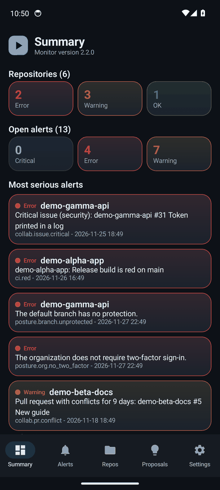

<p align="center">
  
</p>

# 🛠️ TOOLS-GITHUB-ACTIONS-MONITOR-ANDROID

<p align="center"><a href="README.md">🇺🇸 English</a> | <a href="README_spa.md">🇪🇸 Español</a> | <a href="README_fra.md">🇫🇷 Français</a> | 🇮🇹 <b>Italiano</b> | <a href="README_deu.md">🇩🇪 Deutsch</a> | <a href="README_zho.md">🇨🇳 中文</a> | <a href="README_jpn.md">🇯🇵 日本語</a> | <a href="README_por.md">🇵🇹 Português</a></p>

### Client Android nativo di GitHub Actions Monitor: riepilogo, avvisi, repository e proposte della sua IA sul telefono, in sola lettura.

<p align="center">
  
  
  
  
  
  
</p>

---

**Preliminare: non provata su un telefono reale.** Il client è verificato contro monitor dimostrativi (dati inventati) in GitHub Actions e le schermate sono fotografate in un emulatore, ma l’app non è stata vista su un telefono e non ha parlato con un monitor in uso quotidiano. Non invia notifiche push: il monitor non ha ancora un servizio push.

---

> **Stato di sicurezza funzionale e informatica:** questa app legge un monitor; a parte accedere e uscire non cambia nulla, e le proposte si approvano o rifiutano solo sul computer del monitor. Non è un sistema di sicurezza (safety) di alcuna macchina.

## 📋 In breve

| | |
|---|---|
| Versione | `0.1.1` |
| Maturità | Impalcatura |
| Test | 75 |
| Stack tecnologico | Kotlin, Jetpack Compose (Android 8.0+) |
| Su hardware reale | Non testata su un telefono reale (preliminare) |

**Vai a:** [Panoramica](#-panoramica) · [Architettura](#-architettura) · [Avvio rapido](#-avvio-rapido) · [Test](#-test) · [Struttura del repository](#-struttura-del-repository) · [Progetti correlati](#-progetti-correlati)

## 🚦 Stato del progetto

Ogni riga è una parte di questo repository e il semaforo dice a che punto è oggi. È scritta in base a ciò che il repository può mostrare (test, compilazioni, esecuzioni), non a ciò che è previsto.

🟢 Fatto e verificato · 🟡 Funziona, con limiti noti · 🟠 Fatto a metà o non ancora verificato · 🔴 Non fatto o non funzionante

| Area | Stato | Cosa significa qui |
|---|---|---|
| Controlli del repository | 🟡 | Il controllo del repository, quello delle immagini, i controlli leggeri dell'app (otto lingue, risorse, segreti) e i loro test vengono eseguiti nella CI. |
| Regole e client del monitor | 🟡 | Sono scritti 64 test unitari JVM, tra cui il client contro risposte registrate da un monitor dimostrativo; la CI li esegue con Gradle, controlla quanti ne sono stati eseguiti e lancia il client contro monitor dimostrativi in esecuzione. |
| Schermate e Keystore | 🟠 | Fotografate in un emulatore contro un monitor dimostrativo; mai eseguite su un telefono. |
| Notifiche push | 🔴 | Il monitor non ha un servizio push: l’app non offre alcun interruttore e non chiede permessi. |
| Percorsi del monitor | 🟡 | Verificati contro il monitor dimostrativo del commit fissato in `.github/workflows/ci.yml`; non contro un monitor in uso quotidiano. |

## 🎯 Panoramica

* **Il monitor in tasca:** riepilogo, avvisi, repository e proposte di un GitHub Actions Monitor in modalità rete.
* **Si identifica come chiede il monitor:** il token di accesso della modalità rete e, se il monitor ha utenti, la sessione di una persona.
* **Sola lettura:** le proposte mostrano il comando esatto e il suo hash; l’approvazione avviene sul computer del monitor.
* **Nulla di segreto nel repository:** i token sono sigillati con una chiave del Keystore di Android; qui non ci sono file Firebase, chiavi o keystore.

## 🧩 Ruolo in EH3D

TOOLS-GITHUB-ACTIONS-MONITOR-ANDROID è l'app Android di GitHub Actions Monitor (TOOLS-GITHUB-ACTIONS-MONITOR). È un client: non calcola regole proprie su avvisi o proposte; il monitor decide cosa è critico e cosa è una proposta, e l'app lo mostra e interpella una persona.

## 🏛️ Architettura

<p align="center">
  
</p>

Come si incastrano le parti di questo repository: chi lo usa, che cosa contiene e da che cosa dipende. L'immagine è disegnata da `docs/architecture.json` e verificata rispetto al codice.

## ✨ Funzionalità

* Cinque schermate: riepilogo, avvisi (filtro per livello), repository (ordinati per rischio, ricerca per nome), proposte (in attesa o tutte, con dettaglio) e impostazioni.
* Accesso e uscita quando il monitor lavora in modalità team; ogni rifiuto del monitor ha il proprio messaggio.
* I link `ghamon://proposal/<id>?hash=<hex>` aprono una proposta e avvisano se il contenuto è cambiato da quando il link è stato creato.
* Otto lingue che seguono la lingua del telefono: inglese, spagnolo, tedesco, francese, italiano, giapponese, cinese e portoghese europeo.

Le immagini mostrano l’app in un emulatore, contro un monitor dimostrativo con dati inventati:

<table><tr><td align="center"><br>Accesso</td><td align="center"><br>Riepilogo</td><td align="center"><br>Avvisi</td><td align="center"><br>Repository</td><td align="center"><br>Proposte</td></tr></table>

## 🔒 Sicurezza e protezione

* Il token di accesso e la sessione sono sigillati con AES-GCM con una chiave del Keystore di Android, non vengono mai scritti in un log o in un testo d’errore e sono inviati solo all’indirizzo digitato; cambiando indirizzo vengono eliminati, e i reindirizzamenti non vengono mai seguiti.
* La password viene inviata una volta per accedere e non viene conservata.
* `http://` in chiaro è accettato solo per localhost, nomi `.local` e indirizzi IPv4 privati; ogni altro host richiede `https://`, verificato solo con le autorità di sistema.
* Un link apre soltanto una proposta; dal telefono non si approva né si esegue nulla.
* I dati dell’app sono esclusi dai backup, e `python -I tools/check_app.py` fallisce se nell’albero c’è un file Firebase, un keystore o una chiave.

## 🔌 Interfacce

* Letture: `GET /api/auth/me`, `/api/health`, `/api/alerts`, `/api/team/health`, `/api/ai/actions` e `/api/accounts` (solo con più account).
* Accesso e uscita: `POST /api/auth/login` (`client: "api"`) e `POST /api/auth/logout`.
* Intestazioni: `X-Monitor-Access` con il token di accesso e, in modalità team, `Authorization: Bearer` con la sessione.
* Link: `ghamon://proposal/<id>?hash=<64 caratteri esadecimali>`.

## ⚙️ Configurazione

Ogni valore regolabile è in `app/src/main/assets/app_config.json`: i percorsi, i tempi, il limite di dimensione, la regola push e lo schema del link. L’indirizzo del monitor, il token di accesso e l’utente si digitano nelle impostazioni e restano sul telefono.

Sul monitor serve `listen.network` attivo; un nome (non un indirizzo) usato per raggiungerlo va in `listen.allowed_hosts`; impostate il token di accesso in `MONITOR_ACCESS_TOKEN` perché non cambi a ogni avvio; con gli utenti (modalità team) attivate anche `auth.allow_bearer`.

## 🚀 Avvio rapido

Per compilare servono JDK 21 e l'SDK di Android (Android Studio porta entrambi); i controlli leggeri richiedono solo Python 3.10 o successivo. Apri l'app, vai in Impostazioni, digita l'indirizzo del tuo monitor e il suo token e salva.

```bash
./gradlew testDebugUnitTest lintDebug
python -I tools/check_app.py
python -I tools/ci_validate.py
python -I tools/make_architecture.py --check
python -I tools/make_structure.py --check --readmes
python -I -m unittest discover -s tools -p "test_*.py"
```

## 🧪 Test

64 test unitari girano sulla JVM (`./gradlew testDebugUnitTest`) senza telefono: il client contro risposte registrate da un monitor dimostrativo, i rifiuti, i link, le impostazioni e la regola push. Cinque parlano con monitor dimostrativi in esecuzione e vengono saltati se il job CI "contract" non li avvia. 11 test Python coprono il repository e i controlli leggeri dell’app. Nulla è stato eseguito su un telefono.

## 🏗️ Compilazione e rilascio

La versione vive in `VERSION`, in `electro-hobby-3d.project.json` e in `app/build.gradle.kts` (la build si ferma se differiscono), e ogni versione ha la sua voce in [CHANGELOG.md](CHANGELOG.md). La build di rilascio è ridotta con R8 e firmata poi con la chiave propria del maintainer, tenuta fuori dal repository. La prima versione è preliminare: non è stata testata su un telefono reale. GitHub Actions compila l'APK (il workflow "APK build (manual)", avviato a mano e senza chiave di firma) e il maintainer lo firma con la propria chiave e lo pubblica come prerelease insieme a `SHA256SUMS`. **Per installare:** scarica `TOOLS-GITHUB-ACTIONS-MONITOR-ANDROID-release.apk` dall'ultima release nella pagina Releases, verificalo con `sha256sum -c SHA256SUMS`, consenti l'installazione da quella fonte nelle impostazioni del telefono (Android 8.0 o successivo) e apri il file, oppure esegui `adb install TOOLS-GITHUB-ACTIONS-MONITOR-ANDROID-release.apk`. **Per aggiornare:** installa l'APK più recente sopra quello vecchio; le impostazioni restano perché la firma è la stessa e il codice di versione è più alto, e il token resta sigillato nel Keystore. Se Android rifiuta l'aggiornamento, la firma non è la stessa: rimuovi prima la vecchia app (token e impostazioni vanno persi).

## 📂 Struttura del repository

<p align="center">
  
</p>

<details>
<summary>Versione testuale dell'albero</summary>

```text
MONITOR-ANDROID/
├── app/
│   ├── build.gradle.kts proguard-rules.pro                la compilazione e le regole di riduzione
│   ├── src/main/AndroidManifest.xml                       permessi, activity, link ghamon://
│   ├── src/main/assets/app_config.json                    percorsi, timeout, limite, regola push
│   ├── src/main/res/                                      i testi in otto lingue, icone e temi
│   ├── src/main/java/es/electrohobby3d/ghamonitor/core/   regole testate sulla JVM
│   ├── src/main/java/es/electrohobby3d/ghamonitor/        schermate, view model, tema, Keystore
│   ├── src/test/java/es/electrohobby3d/ghamonitor/core/   i test unitari sulla JVM
│   ├── src/test/resources/contract/                       risposte registrate da un monitor demo
│   └── src/androidTest/                                   le immagini in un emulatore
├── tools/
│   ├── ci_validate.py                                     manifesto, versioni, parità dei README
│   ├── check_app.py                                       lingue, risorse, configurazione e segreti dell'app
│   ├── make_architecture.py make_structure.py             disegnano le due immagini del README
│   └── contract/                                          monitor demo e registrazione risposte
├── docs/                                                  le sorgenti delle due immagini
├── gradle/                                                i file del wrapper Gradle
├── gradlew                                                il wrapper Gradle
├── gradlew.bat                                            il wrapper Gradle
├── build.gradle.kts                                       i plugin e il nome della build
├── settings.gradle.kts                                    i plugin e il nome della build
├── gradle.properties                                      la memoria della build
├── images/                                                banner e le due immagini
├── .github/                                               workflow di CI e modelli
├── VERSION                                                la versione del repository
├── electro-hobby-3d.project.json                          il manifesto del progetto
├── CHANGELOG.md                                           cosa è cambiato in ogni versione
├── SECURITY.md SUPPORT.md                                 come segnalare una vulnerabilità e dove chiedere
└── CONTRIBUTING.md CODE_OF_CONDUCT.md LICENSE             come contribuire, codice di condotta e licenza
```

</details>

## 🗺️ Roadmap e limiti noti

**Limiti noti oggi**

* Versione preliminare: l’app non è stata eseguita su un telefono.
* L’edizione Lite del monitor non ha avvisi, repository né proposte; l’app può solo dirlo.
* Nessun servizio push: il monitor non invia ancora messaggi push.
* L’abbinamento con il codice QR del monitor non è supportato; il token di accesso si digita.

**Prossimi passi**

* Provarla su un telefono con un monitor reale, poi l’abbinamento con QR, e il push quando il monitor lo offrirà.

## 🌍 Lingue

Il README e i testi esistono in inglese, spagnolo, francese, italiano, tedesco, cinese, giapponese e portoghese europeo.

## 🔗 Progetti correlati

* [TOOLS-GITHUB-ACTIONS-MONITOR](https://github.com/JuanenRac/TOOLS-GITHUB-ACTIONS-MONITOR): il monitor di cui questa app è client
* [EH3D-DOCS](https://github.com/JuanenRac/EH3D-DOCS): le convenzioni e i controlli condivisi

## 📚 Documentazione

* [Le convenzioni della suite](https://github.com/JuanenRac/EH3D-DOCS/blob/main/docs/CONVENTIONS.md)
* [Registro delle modifiche](CHANGELOG.md)

## 🤝 Contribuire e comunità

* Prima di una pull request esegui `python -I tools/ci_validate.py` e `python -I tools/check_app.py`; la build Gradle, i test e il lint girano nella CI. Vedi [CONTRIBUTING.md](CONTRIBUTING.md) e il [codice di condotta](CODE_OF_CONDUCT.md).
* Il README esiste in otto lingue: una modifica al testo si fa in tutti e otto i file, e le due immagini sono disegnate da `docs/architecture.json` e `docs/structure.json` con `tools/make_architecture.py` e `tools/make_structure.py`.
* Segnala una vulnerabilità in privato: [SECURITY.md](SECURITY.md). Domande, idee e segnalazioni: electrohobby3d@gmail.com ([SUPPORT.md](SUPPORT.md)).

## 👤 AUTORE

**JuanenRac (Electro Hobby 3D)** · electrohobby3d@gmail.com

## 📜 LICENZA

Software: GPL-3.0-or-later. Vedi [LICENSE](LICENSE). I progetti hardware della suite usano la CERN OHL-S.
