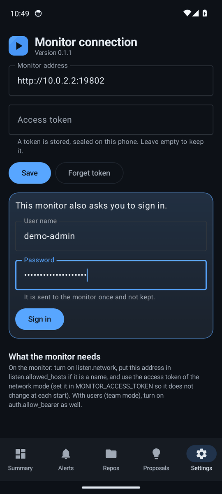

<p align="center">
  
</p>

# 🛠️ TOOLS-GITHUB-ACTIONS-MONITOR-ANDROID

<p align="center"><a href="README.md">🇺🇸 English</a> | <a href="README_spa.md">🇪🇸 Español</a> | <a href="README_fra.md">🇫🇷 Français</a> | <a href="README_ita.md">🇮🇹 Italiano</a> | <a href="README_deu.md">🇩🇪 Deutsch</a> | <a href="README_zho.md">🇨🇳 中文</a> | 🇯🇵 <b>日本語</b> | <a href="README_por.md">🇵🇹 Português</a></p>

### GitHub Actions Monitor のネイティブ Android クライアント: 概要、アラート、リポジトリ、AI の提案をスマートフォンで閲覧 (読み取り専用)。

<p align="center">
  
  
  
  
  
  
</p>

---

**プレビュー版: 実機では未テストです。** クライアントは GitHub Actions 上のデモモニター (架空のデータ) で確認し、画面はエミュレーターで撮影していますが、実機で表示したことも、日常運用中のモニターと通信したこともありません。プッシュ通知は送りません。モニターにはまだプッシュサービスがありません。

---

> **安全性とセキュリティの現状：** このアプリはモニターを読み取ります。サインインとサインアウト以外は何も変更せず、提案の承認と却下はモニターを動かすコンピューターでのみ行います。いかなる機械の安全装置でもありません。

## 📋 ひと目で

| | |
|---|---|
| バージョン | `0.1.1` |
| 成熟度 | 足場 |
| テスト | 75 |
| 技術スタック | Kotlin、Jetpack Compose（Android 8.0 以上） |
| 実機での動作 | 実際のスマートフォンでは未テスト（暫定版） |

**移動先：** [概要](#-概要) · [アーキテクチャ](#-アーキテクチャ) · [クイックスタート](#-クイックスタート) · [テスト](#-テスト) · [リポジトリの構成](#-リポジトリの構成) · [関連プロジェクト](#-関連プロジェクト)

## 🚦 プロジェクトの状況

各行はこのリポジトリの一部分で、信号は今日どこまで進んでいるかを示します。計画ではなく、リポジトリが示せるもの（テスト、ビルド、実行）に基づいて書かれています。

🟢 完了・検証済み · 🟡 動作する（既知の制限あり） · 🟠 一部のみ、または未検証 · 🔴 未実装または動作しない

| 領域 | 状態 | ここでの意味 |
|---|---|---|
| リポジトリ チェック | 🟡 | リポジトリのチェック、画像のチェック、アプリの軽量チェック（8 言語、リソース、機密）とそのテストが CI で実行されます。 |
| ルールとモニタークライアント | 🟡 | デモモニターから記録した応答に対するクライアントを含む 64 件の JVM 単体テストがあり、CI が Gradle で実行して件数を確認し、稼働中のデモモニターに対してもクライアントを実行します。 |
| 画面と Keystore | 🟠 | エミュレーターでデモモニターに対して撮影しました。実機では未実行です。 |
| プッシュ通知 | 🔴 | モニターにプッシュサービスがないため、アプリはスイッチを表示せず権限も要求しません。 |
| モニターのルート | 🟡 | `.github/workflows/ci.yml` で固定したコミットのデモモニターで確認しました。日常運用中のモニターでは未確認です。 |

## 🎯 概要

* **ポケットの中のモニター:** ネットワークモードの GitHub Actions Monitor の概要、アラート、リポジトリ、提案。
* **モニターが求める方法で認証:** ネットワークモードのアクセストークンと、ユーザーを使う場合は個人のセッション。
* **読み取り専用:** 提案は正確なコマンドとハッシュを表示します。承認はモニターのコンピューターで行います。
* **リポジトリに秘密はありません:** トークンは Android Keystore の鍵で封印されます。Firebase ファイル、鍵、キーストアはありません。

## 🧩 EH3D での役割

TOOLS-GITHUB-ACTIONS-MONITOR-ANDROID は GitHub Actions Monitor（TOOLS-GITHUB-ACTIONS-MONITOR）の Android アプリです。クライアントであり、アラートや提案について独自のルールを計算しません。何が重大か、何が提案かはモニターが決め、アプリはそれを表示して人に確認します。

## 🏛️ アーキテクチャ

<p align="center">
  
</p>

このリポジトリの各部分の関係：誰が使い、何を持ち、何に依存するか。図は `docs/architecture.json` から描かれ、コードと照合されます。

## ✨ 機能

* 5 つの画面: 概要、アラート (レベルで絞り込み)、リポジトリ (リスク順、名前で検索)、提案 (保留中またはすべて、詳細付き)、設定。
* モニターがチームモードの場合はサインインとサインアウト。モニターの拒否理由ごとに専用のメッセージを表示します。
* リンク `ghamon://proposal/<id>?hash=<hex>` は提案を 1 件開き、作成後に内容が変わっていれば警告します。
* 端末の言語に合わせる 8 言語: 英語、スペイン語、ドイツ語、フランス語、イタリア語、日本語、中国語、ヨーロッパポルトガル語。

画像は、架空データのデモモニターに接続したエミュレーター上のアプリです。

<table><tr><td align="center"><br>サインイン</td><td align="center"><br>概要</td><td align="center"><br>アラート</td><td align="center"><br>リポジトリ</td><td align="center"><br>提案</td></tr></table>

## 🔒 セキュリティと安全

* アクセストークンとセッションは Android Keystore の鍵を使い AES-GCM で封印し、ログやエラー文には書かず、入力したアドレスにのみ送ります。アドレスを変えると破棄し、リダイレクトは追いません。
* パスワードはサインインのために一度だけ送り、保存しません。
* 平文の `http://` は localhost、`.local` 名、プライベート IPv4 アドレスのみ受け付けます。その他のホストには `https://` が必要で、システムの認証局のみで検証します。
* リンクは提案を開くだけです。端末から承認や実行は行いません。
* アプリのデータはバックアップから除外され、Firebase ファイル、キーストア、鍵がツリーにあると `python -I tools/check_app.py` は失敗します。

## 🔌 インターフェース

* 読み取り: `GET /api/auth/me`、`/api/health`、`/api/alerts`、`/api/team/health`、`/api/ai/actions`、`/api/accounts` (複数アカウントのみ)。
* サインインとサインアウト: `POST /api/auth/login` (`client: "api"`) と `POST /api/auth/logout`。
* ヘッダー: アクセストークンは `X-Monitor-Access`、チームモードではセッションを `Authorization: Bearer` で送ります。
* リンク: `ghamon://proposal/<id>?hash=<16 進数 64 文字>`。

## ⚙️ 設定

調整できる値はすべて `app/src/main/assets/app_config.json` にあります: パス、タイムアウト、サイズ上限、プッシュのルール、リンクのスキーム。モニターのアドレス、アクセストークン、ユーザーはアプリの設定で入力し、端末に保存します。

モニター側では `listen.network` を有効にします。接続に使う名前 (アドレスではない) は `listen.allowed_hosts` に追加します。起動のたびに変わらないようにアクセストークンを `MONITOR_ACCESS_TOKEN` に設定します。ユーザーを使う場合 (チームモード) は `auth.allow_bearer` も有効にします。

## 🚀 クイックスタート

ビルドには JDK 21 と Android SDK が必要です（Android Studio に両方含まれます）。軽量チェックには Python 3.10 以上のみが必要です。アプリを開き、設定でモニターのアドレスとトークンを入力して保存してください。

```bash
./gradlew testDebugUnitTest lintDebug
python -I tools/check_app.py
python -I tools/ci_validate.py
python -I tools/make_architecture.py --check
python -I tools/make_structure.py --check --readmes
python -I -m unittest discover -s tools -p "test_*.py"
```

## 🧪 テスト

64 件の単体テストが JVM 上で端末なしに実行されます (`./gradlew testDebugUnitTest`): デモモニターから記録した応答に対するクライアント、拒否、リンク、設定、プッシュのルール。うち 5 件は稼働中のデモモニターと通信し、CI ジョブ "contract" が起動しない限りスキップされます。11 件の Python テストがリポジトリとアプリの軽量チェックを扱います。実機では何も実行していません。

## 🏗️ ビルドとリリース

バージョンは `VERSION`、`electro-hobby-3d.project.json`、`app/build.gradle.kts` にあり（異なるとビルドが止まります）、各バージョンには [CHANGELOG.md](CHANGELOG.md) の項目があります。リリースビルドは R8 で縮小され、そのあとリポジトリの外に保管されたメンテナー自身の鍵で署名されます。最初のリリースは暫定版で、実際のスマートフォンではテストしていません。APK は GitHub Actions がビルドし（ワークフロー「APK build (manual)」、手動で起動、署名鍵は含まれません）、メンテナーが自分の鍵で署名し、`SHA256SUMS` とともにプレリリースとして公開します。**インストール：** Releases ページの最新リリースから `TOOLS-GITHUB-ACTIONS-MONITOR-ANDROID-release.apk` をダウンロードし、`sha256sum -c SHA256SUMS` で確認し、スマートフォンの設定でその提供元からのインストールを許可して（Android 8.0 以上）ファイルを開くか、`adb install TOOLS-GITHUB-ACTIONS-MONITOR-ANDROID-release.apk` を実行します。**更新：** 新しい APK を古いものの上にインストールします。署名が同じでバージョンコードが大きいため設定は残り、トークンは Keystore で封印されたままです。Android が更新を拒否する場合は署名が異なるので、先に古いアプリを削除してください（トークンと設定は失われます）。

## 📂 リポジトリの構成

<p align="center">
  
</p>

<details>
<summary>ツリーのテキスト版</summary>

```text
MONITOR-ANDROID/
├── app/
│   ├── build.gradle.kts proguard-rules.pro                ビルドと縮小ルール
│   ├── src/main/AndroidManifest.xml                       権限、アクティビティ、ghamon:// リンク
│   ├── src/main/assets/app_config.json                    パス、タイムアウト、サイズ上限、プッシュ規則
│   ├── src/main/res/                                      8 言語のテキスト、アイコン、テーマ
│   ├── src/main/java/es/electrohobby3d/ghamonitor/core/   JVM でテスト済みのルール
│   ├── src/main/java/es/electrohobby3d/ghamonitor/        画面、ViewModel、テーマ、Keystore
│   ├── src/test/java/es/electrohobby3d/ghamonitor/core/   JVM 上のユニットテスト
│   ├── src/test/resources/contract/                       デモモニターから記録した応答
│   └── src/androidTest/                                   エミュレーターでのスクリーンショット
├── tools/
│   ├── ci_validate.py                                     マニフェスト、バージョン、README の整合
│   ├── check_app.py                                       アプリの言語、リソース、設定、機密
│   ├── make_architecture.py make_structure.py             README の 2 つの図を描く
│   └── contract/                                          デモモニターと応答の記録
├── docs/                                                  2 つの図の元データ
├── gradle/                                                Gradle ラッパーのファイル
├── gradlew                                                Gradle ラッパー
├── gradlew.bat                                            Gradle ラッパー
├── build.gradle.kts                                       プラグインとビルド名
├── settings.gradle.kts                                    プラグインとビルド名
├── gradle.properties                                      ビルドのメモリ設定
├── images/                                                バナーと 2 つの図
├── .github/                                               CI ワークフローとテンプレート
├── VERSION                                                リポジトリのバージョン
├── electro-hobby-3d.project.json                          プロジェクトのマニフェスト
├── CHANGELOG.md                                           各バージョンの変更点
├── SECURITY.md SUPPORT.md                                 脆弱性の報告方法と問い合わせ先
└── CONTRIBUTING.md CODE_OF_CONDUCT.md LICENSE             貢献方法、行動規範、ライセンス
```

</details>

## 🗺️ ロードマップと既知の制限

**現在の既知の制限**

* プレビュー版: 実機では実行していません。
* モニターの Lite 版にはアラート、リポジトリ、提案がなく、アプリはそのことを表示するだけです。
* プッシュサービスはありません。モニターはまだプッシュを送りません。
* モニターの QR コードによるペアリングには未対応で、アクセストークンは手入力です。

**今後**

* 実機と実際のモニターで試し、次に QR ペアリング、モニターが対応したらプッシュ。

## 🌍 言語

README とテキストは、英語、スペイン語、フランス語、イタリア語、ドイツ語、中国語、日本語、ヨーロッパポルトガル語で提供されています。

## 🔗 関連プロジェクト

* [TOOLS-GITHUB-ACTIONS-MONITOR](https://github.com/JuanenRac/TOOLS-GITHUB-ACTIONS-MONITOR)：このアプリがクライアントとなるモニター
* [EH3D-DOCS](https://github.com/JuanenRac/EH3D-DOCS)：規約と共通チェック

## 📚 ドキュメント

* [スイートの規約](https://github.com/JuanenRac/EH3D-DOCS/blob/main/docs/CONVENTIONS.md)
* [変更履歴](CHANGELOG.md)

## 🤝 コントリビュートとコミュニティ

* プルリクエストの前に `python -I tools/ci_validate.py` と `python -I tools/check_app.py` を実行してください。Gradle のビルド、テスト、lint は CI で実行されます。[CONTRIBUTING.md](CONTRIBUTING.md) と[行動規範](CODE_OF_CONDUCT.md)を参照してください。
* README は 8 言語あります。文章を変更するときは 8 つのファイルすべてを変更し、2 つの図は `docs/architecture.json` と `docs/structure.json` から `tools/make_architecture.py` と `tools/make_structure.py` で描画します。
* 脆弱性は非公開で報告してください：[SECURITY.md](SECURITY.md)。質問、アイデア、報告：electrohobby3d@gmail.com（[SUPPORT.md](SUPPORT.md)）。

## 👤 作者

**JuanenRac (Electro Hobby 3D)** · electrohobby3d@gmail.com

## 📜 ライセンス

ソフトウェア：GPL-3.0-or-later。[LICENSE](LICENSE) を参照。スイートのハードウェア設計には CERN OHL-S を使います。
