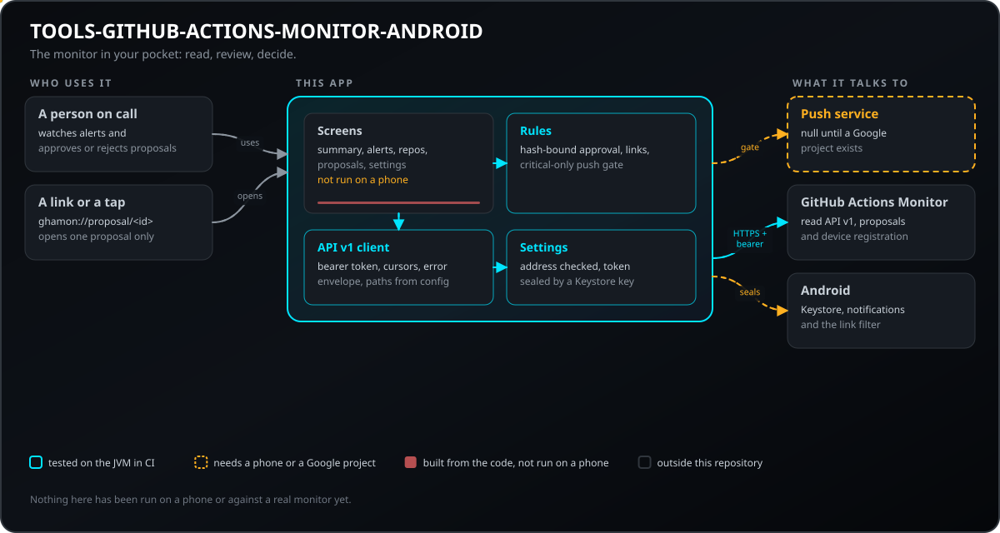

<p align="center">
  
</p>

# 🛠️ TOOLS-GITHUB-ACTIONS-MONITOR-ANDROID

<p align="center"><a href="README.md">🇺🇸 English</a> | <a href="README_spa.md">🇪🇸 Español</a> | <a href="README_fra.md">🇫🇷 Français</a> | <a href="README_ita.md">🇮🇹 Italiano</a> | <a href="README_deu.md">🇩🇪 Deutsch</a> | <a href="README_zho.md">🇨🇳 中文</a> | <a href="README_jpn.md">🇯🇵 日本語</a> | 🇵🇹 <b>Português</b></p>

### Aplicação Android prevista do GitHub Actions Monitor: o estado dos teus workflows e os alertas do teu próprio monitor no telemóvel. Apenas estrutura inicial: ainda nada está implementado.

<p align="center">
  
  
  
  
  
  
</p>

---

**Verificação de honestidade - o que corre hoje:** nada da aplicação. Este repositório contém apenas a sua base: os documentos, o manifesto, a licença e as verificações partilhadas do repositório. Não há código, nem APK, nem ecrã, nem serviço de notificações, nem testes da aplicação, e nada foi experimentado num telemóvel.

---

## 📋 Num relance

| | |
|---|---|
| Versão | `0.0.1` |
| Maturidade | Estrutura inicial |
| Testes | Nenhum por enquanto (apenas as verificações do repositório) |
| Tecnologias | Kotlin e Jetpack Compose (previsto) |
| Em hardware real | Nunca executada num telemóvel |

**Ir para:** [Visão geral](#-visão-geral) · [Arquitetura](#-arquitetura) · [Início rápido](#-início-rápido) · [Testes](#-testes) · [Estrutura do repositório](#-estrutura-do-repositório) · [Projetos relacionados](#-projetos-relacionados)

## 🚦 Estado do projeto

Cada linha é uma parte deste repositório e a luz diz até onde chega hoje. É escrita com o que o repositório consegue demonstrar (testes, compilações, execuções), não com o que está previsto.

🟢 Feito e verificado · 🟡 Funciona, com limites conhecidos · 🟠 Feito a meio ou ainda por verificar · 🔴 Por fazer ou a não funcionar

| Área | Estado | O que significa aqui |
|---|---|---|
| Base do repositório | 🟡 | O manifesto, os README em oito idiomas, a licença e as verificações partilhadas do repositório correm no CI. |
| Código da aplicação | 🔴 | Por começar: este repositório ainda não tem nenhum projeto Android. |
| Testes | 🔴 | A aplicação não tem testes; só correm as verificações do repositório. |
| Ligação ao monitor | 🔴 | Por começar. O monitor oferece uma API de leitura que um cliente pode usar; esta aplicação ainda não a usa. |
| Telemóvel e notificações | 🔴 | Por começar e nunca executada num telemóvel; nenhum serviço de notificações está ligado. |

## 🎯 Visão geral

* **O que será:** uma aplicação Android que mostra, no teu telemóvel, o estado dos workflows e os alertas do teu próprio GitHub Actions Monitor.
* **Só leitura:** só lerá do teu monitor. Não escreverá no GitHub nem alterará nada no monitor.
* **O teu monitor, os teus dados:** falará com o monitor que tu próprio executas, com um token de acesso que lhe deres; não há nenhum serviço nosso pelo meio.
* **O que não é (ainda):** não há aplicação para instalar, nem release, nem data. Este repositório apenas reserva o seu lugar e diz com honestidade o que está previsto.

## 🧩 Papel no EH3D

TOOLS-GITHUB-ACTIONS-MONITOR-ANDROID pretende ser o cliente Android do GitHub Actions Monitor ([TOOLS-GITHUB-ACTIONS-MONITOR](https://github.com/JuanenRac/TOOLS-GITHUB-ACTIONS-MONITOR)). Mostraria o que o monitor já sabe e não decidiria nada por si. Está prevista uma versão mínima para relógio, [TOOLS-GITHUB-ACTIONS-MONITOR-WATCH](https://github.com/JuanenRac/TOOLS-GITHUB-ACTIONS-MONITOR-WATCH), que siga esta aplicação.

## 🏛️ Arquitetura

<p align="center">
  
</p>

Como as partes deste repositório se encaixam: quem o usa, o que contém e de que depende. A imagem é desenhada a partir de `docs/architecture.json` e verificada com o código.

## ✨ Funcionalidades

**Previsto, e nada disto existe ainda:**
* O resumo dos teus workflows (o que está a vermelho, bloqueado ou à espera) e os alertas do monitor.
* Uma lista de repositórios com o respetivo estado.
* Notificações opcionais para alertas importantes, desativadas por predefinição.
* Textos em oito idiomas.

**Não previsto:** escrever no GitHub, voltar a executar workflows a partir do telemóvel ou enviar os teus dados para qualquer serviço que não seja o teu próprio monitor.

## 🔒 Segurança e proteção

* Previsto: a aplicação só lê, e o token de acesso fica no telemóvel e é enviado apenas para o endereço do teu monitor.
* Nada de secreto tem lugar neste repositório: nem chaves, nem tokens, nem ficheiros de serviços de notificações, nem chaves de assinatura.
* São intenções de conceção. Nada disto existe ainda, pelo que ninguém o pôde rever.

## 🚀 Início rápido

Ainda não há nada para instalar nem para executar. Para verificar a base deste repositório precisas de Python 3.10 ou posterior:

```bash
python -I tools/ci_validate.py
python -I tools/make_architecture.py --check
python -I tools/make_structure.py --check --readmes
python -I -m unittest discover -s tools -p "test_*.py"
```

## 🧪 Testes

O CI executa as verificações do repositório e os testes dessas verificações. A aplicação não tem testes próprios porque ainda não tem código, e aqui não se afirma nenhum número de testes.

## 🏗️ Compilação e publicação

Não há compilação nem release, porque não existe nenhuma versão da aplicação. A versão `0.0.1` de `VERSION`, do manifesto e do registo de alterações é a da base do repositório.

## 📂 Estrutura do repositório

<p align="center">
  
</p>

<details>
<summary>Versão em texto da árvore</summary>

```text
MONITOR-ANDROID/
├── tools/
│   ├── ci_validate.py                           manifesto, versões, paridade dos README
│   └── make_architecture.py make_structure.py   desenham as duas imagens do README
├── docs/                                        as fontes das duas imagens
├── images/                                      banner e as duas imagens
├── .github/                                     fluxos de CI e modelos
├── VERSION                                      a versão do repositório
├── electro-hobby-3d.project.json                o manifesto do projeto
├── CHANGELOG.md                                 o que mudou em cada versão
├── SECURITY.md SUPPORT.md                       como comunicar uma vulnerabilidade e onde perguntar
└── CONTRIBUTING.md CODE_OF_CONDUCT.md LICENSE   como contribuir, o código de conduta e a licença
```

</details>

## 🗺️ Roteiro e limites conhecidos

**Limites conhecidos hoje**

* Não há código: nem aplicação, nem APK, nem ecrã.
* Nada foi experimentado num telemóvel nem com um monitor real.
* O âmbito final depende da API de leitura do monitor e pode mudar.

**A seguir**

* Decidir os primeiros ecrãs, construir a aplicação passo a passo com os seus testes no CI e só então descrevê-la aqui como funcional.

## 🌍 Idiomas

O README e os textos existem em inglês, espanhol, francês, italiano, alemão, chinês, japonês e português europeu.

## 🔗 Projetos relacionados

* [TOOLS-GITHUB-ACTIONS-MONITOR](https://github.com/JuanenRac/TOOLS-GITHUB-ACTIONS-MONITOR): o monitor que esta aplicação pretende ler
* [TOOLS-GITHUB-ACTIONS-MONITOR-WATCH](https://github.com/JuanenRac/TOOLS-GITHUB-ACTIONS-MONITOR-WATCH): a versão mínima para relógio prevista, que segue esta aplicação
* [EH3D-DOCS](https://github.com/JuanenRac/EH3D-DOCS): as convenções e as verificações partilhadas

## 📚 Documentação

* [As convenções da suite](https://github.com/JuanenRac/EH3D-DOCS/blob/main/docs/CONVENTIONS.md)
* [Registo de alterações](CHANGELOG.md)

## 🤝 Contribuir e comunidade

* Antes de um pull request executa `python -I tools/ci_validate.py`; as restantes verificações correm no CI. Consulta [CONTRIBUTING.md](CONTRIBUTING.md) e o [código de conduta](CODE_OF_CONDUCT.md).
* O README existe em oito idiomas: uma alteração ao texto faz-se nos oito ficheiros, e as duas imagens são desenhadas a partir de `docs/architecture.json` e `docs/structure.json` com `tools/make_architecture.py` e `tools/make_structure.py`.
* Comunica uma vulnerabilidade em privado: [SECURITY.md](SECURITY.md). Perguntas, ideias e relatos: electrohobby3d@gmail.com ([SUPPORT.md](SUPPORT.md)).

## 👤 AUTOR

**JuanenRac (Electro Hobby 3D)** · electrohobby3d@gmail.com

## 📜 LICENÇA

Software: GPL-3.0-or-later. Ver [LICENSE](LICENSE). Os projetos de hardware da suite usam a CERN OHL-S.
