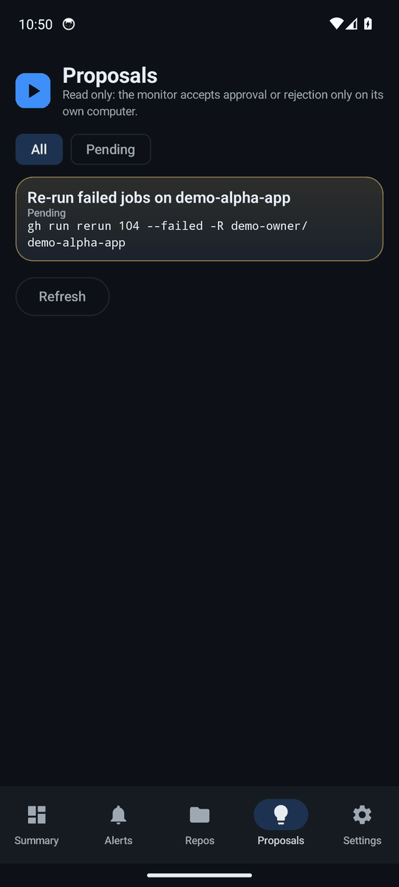

<p align="center">
  
</p>

# 🛠️ TOOLS-GITHUB-ACTIONS-MONITOR-ANDROID

<p align="center"><a href="README.md">🇺🇸 English</a> | <a href="README_spa.md">🇪🇸 Español</a> | <a href="README_fra.md">🇫🇷 Français</a> | <a href="README_ita.md">🇮🇹 Italiano</a> | <a href="README_deu.md">🇩🇪 Deutsch</a> | <a href="README_zho.md">🇨🇳 中文</a> | <a href="README_jpn.md">🇯🇵 日本語</a> | 🇵🇹 <b>Português</b></p>

### Cliente Android nativo do GitHub Actions Monitor: resumo, alertas, repositórios e as propostas da sua IA no telemóvel, apenas em leitura.

<p align="center">
  
  
  
  
  
  
</p>

---

**Preliminar: não testada num telemóvel real.** O cliente é verificado contra monitores de demonstração (dados inventados) no GitHub Actions e os ecrãs são fotografados num emulador, mas a aplicação nunca foi vista num telemóvel nem falou com um monitor em uso diário. Não envia notificações push: o monitor ainda não tem serviço push.

---

> **Estado de segurança (safety) e de segurança informática:** esta aplicação lê um monitor; além de iniciar e terminar sessão não altera nada, e as propostas só são aprovadas ou rejeitadas no computador do monitor. Não é um sistema de segurança (safety) de nenhuma máquina.

## 📋 Num relance

| | |
|---|---|
| Versão | `0.1.1` |
| Maturidade | Estrutura inicial |
| Testes | 75 |
| Tecnologias | Kotlin, Jetpack Compose (Android 8.0+) |
| Em hardware real | Não testada num telemóvel real (preliminar) |

**Ir para:** [Visão geral](#-visão-geral) · [Arquitetura](#-arquitetura) · [Início rápido](#-início-rápido) · [Testes](#-testes) · [Estrutura do repositório](#-estrutura-do-repositório) · [Projetos relacionados](#-projetos-relacionados)

## 🚦 Estado do projeto

Cada linha é uma parte deste repositório e a luz diz até onde chega hoje. É escrita com o que o repositório consegue demonstrar (testes, compilações, execuções), não com o que está previsto.

🟢 Feito e verificado · 🟡 Funciona, com limites conhecidos · 🟠 Feito a meio ou ainda por verificar · 🔴 Por fazer ou a não funcionar

| Área | Estado | O que significa aqui |
|---|---|---|
| Verificações do repositório | 🟡 | A verificação do repositório, a das imagens, as verificações leves da aplicação (oito idiomas, recursos, segredos) e os respetivos testes correm no CI. |
| Regras e cliente do monitor | 🟡 | Estão escritos 64 testes unitários na JVM, entre eles o cliente contra respostas gravadas de um monitor de demonstração; a CI executa-os com o Gradle, verifica quantos correram e corre o cliente contra monitores de demonstração em execução. |
| Ecrãs e Keystore | 🟠 | Fotografados num emulador contra um monitor de demonstração; nunca executados num telemóvel. |
| Notificações push | 🔴 | O monitor não tem serviço push: a aplicação não oferece interruptor nem pede permissão. |
| Rotas do monitor | 🟡 | Verificadas contra o monitor de demonstração do commit fixado em `.github/workflows/ci.yml`; não contra um monitor em uso diário. |

## 🎯 Visão geral

* **O monitor no bolso:** o resumo, os alertas, os repositórios e as propostas de um GitHub Actions Monitor em modo de rede.
* **Identifica-se como o monitor pede:** o token de acesso do modo de rede e, se o monitor tiver utilizadores, a sessão de uma pessoa.
* **Apenas leitura:** as propostas mostram o comando exato e o seu hash; a aprovação faz-se no computador do monitor.
* **Nada secreto no repositório:** os tokens são selados com uma chave do Keystore do Android; aqui não há ficheiros Firebase, chaves nem keystores.

## 🧩 Papel no EH3D

TOOLS-GITHUB-ACTIONS-MONITOR-ANDROID é a aplicação Android do GitHub Actions Monitor (TOOLS-GITHUB-ACTIONS-MONITOR). É um cliente: não calcula regras próprias sobre alertas ou propostas; o monitor decide o que é crítico e o que é uma proposta, e a aplicação mostra-o e pergunta a uma pessoa.

## 🏛️ Arquitetura

<p align="center">
  
</p>

Como as partes deste repositório se encaixam: quem o usa, o que contém e de que depende. A imagem é desenhada a partir de `docs/architecture.json` e verificada com o código.

## ✨ Funcionalidades

* Cinco ecrãs: resumo, alertas (filtro por nível), repositórios (ordenados por risco, pesquisa por nome), propostas (pendentes ou todas, com detalhe) e definições.
* Iniciar e terminar sessão quando o monitor trabalha em modo de equipa; cada recusa do monitor tem a sua própria mensagem.
* As ligações `ghamon://proposal/<id>?hash=<hex>` abrem uma proposta e avisam se o conteúdo mudou desde que a ligação foi criada.
* Oito idiomas que seguem o idioma do telemóvel: inglês, espanhol, alemão, francês, italiano, japonês, chinês e português europeu.

As imagens mostram a aplicação num emulador, contra um monitor de demonstração com dados inventados:

<table><tr><td align="center"><br>Início de sessão</td><td align="center"><br>Resumo</td><td align="center"><br>Alertas</td><td align="center"><br>Repositórios</td><td align="center"><br>Propostas</td></tr></table>

## 🔒 Segurança e proteção

* O token de acesso e a sessão são selados com AES-GCM sob uma chave que vive no Keystore do Android, nunca são escritos num registo nem num texto de erro e só são enviados para o endereço escrito; ao mudar o endereço são eliminados, e os redirecionamentos nunca são seguidos.
* A palavra-passe é enviada uma vez para iniciar sessão e não é guardada.
* `http://` sem cifra só é aceite para localhost, nomes `.local` e endereços IPv4 privados; qualquer outro anfitrião precisa de `https://`, verificado apenas com as autoridades do sistema.
* Uma ligação apenas abre uma proposta; nada é aprovado nem executado a partir do telemóvel.
* Os dados da aplicação ficam fora das cópias de segurança, e `python -I tools/check_app.py` falha se houver um ficheiro Firebase, um keystore ou uma chave na árvore.

## 🔌 Interfaces

* Leituras: `GET /api/auth/me`, `/api/health`, `/api/alerts`, `/api/team/health`, `/api/ai/actions` e `/api/accounts` (apenas com várias contas).
* Iniciar e terminar sessão: `POST /api/auth/login` (`client: "api"`) e `POST /api/auth/logout`.
* Cabeçalhos: `X-Monitor-Access` com o token de acesso e, em modo de equipa, `Authorization: Bearer` com a sessão.
* Ligação: `ghamon://proposal/<id>?hash=<64 caracteres hexadecimais>`.

## ⚙️ Configuração

Todos os valores ajustáveis estão em `app/src/main/assets/app_config.json`: os caminhos, os tempos limite, o limite de tamanho, a regra de push e o esquema da ligação. O endereço do monitor, o token de acesso e o utilizador são escritos nas definições da aplicação e ficam no telemóvel.

O monitor precisa de `listen.network` ligado; um nome (não um endereço) usado para lá chegar vai para `listen.allowed_hosts`; defina o token de acesso em `MONITOR_ACCESS_TOKEN` para não mudar em cada arranque; com utilizadores (modo de equipa) ligue também `auth.allow_bearer`.

## 🚀 Início rápido

Para compilar precisa do JDK 21 e do SDK do Android (o Android Studio traz ambos); as verificações leves só precisam do Python 3.10 ou posterior. Abra a aplicação, vá a Definições, escreva o endereço do seu monitor e o respetivo token e guarde.

```bash
./gradlew testDebugUnitTest lintDebug
python -I tools/check_app.py
python -I tools/ci_validate.py
python -I tools/make_architecture.py --check
python -I tools/make_structure.py --check --readmes
python -I -m unittest discover -s tools -p "test_*.py"
```

## 🧪 Testes

64 testes unitários correm na JVM (`./gradlew testDebugUnitTest`) sem telemóvel: o cliente contra respostas gravadas de um monitor de demonstração, as suas recusas, as ligações, as definições e a regra de push. Cinco deles falam com monitores de demonstração em execução e são ignorados se o trabalho de CI "contract" não os arrancar. 11 testes em Python cobrem o repositório e as verificações leves da aplicação. Nada aqui correu num telemóvel.

## 🏗️ Compilação e publicação

A versão vive em `VERSION`, em `electro-hobby-3d.project.json` e em `app/build.gradle.kts` (a compilação pára se diferirem), e cada versão tem a sua entrada em [CHANGELOG.md](CHANGELOG.md). A compilação de lançamento é reduzida com o R8 e assinada depois com a chave própria do mantenedor, guardada fora do repositório. A primeira versão é preliminar: não foi testada num telemóvel real. O GitHub Actions compila o APK (o workflow "APK build (manual)", iniciado à mão e sem chave de assinatura) e o mantenedor assina-o com a sua própria chave e publica-o como pré-lançamento juntamente com `SHA256SUMS`. **Para instalar:** transfira `TOOLS-GITHUB-ACTIONS-MONITOR-ANDROID-release.apk` do último lançamento na página Releases, verifique-o com `sha256sum -c SHA256SUMS`, permita a instalação a partir dessa origem nas definições do telemóvel (Android 8.0 ou posterior) e abra o ficheiro, ou execute `adb install TOOLS-GITHUB-ACTIONS-MONITOR-ANDROID-release.apk`. **Para atualizar:** instale o APK mais recente por cima do anterior; as definições mantêm-se porque a assinatura é a mesma e o código de versão é superior, e o token continua selado no Keystore. Se o Android recusar a atualização, a assinatura não é a mesma: remova primeiro a aplicação antiga (perdem-se o token e as definições).

## 📂 Estrutura do repositório

<p align="center">
  
</p>

<details>
<summary>Versão em texto da árvore</summary>

```text
MONITOR-ANDROID/
├── app/
│   ├── build.gradle.kts proguard-rules.pro                a compilação e as regras de redução
│   ├── src/main/AndroidManifest.xml                       permissões, atividade, ligação ghamon://
│   ├── src/main/assets/app_config.json                    caminhos, tempos limite, tamanho, regra push
│   ├── src/main/res/                                      os textos em oito idiomas, ícones e temas
│   ├── src/main/java/es/electrohobby3d/ghamonitor/core/   regras testadas na JVM
│   ├── src/main/java/es/electrohobby3d/ghamonitor/        ecrãs, view model, tema, Keystore
│   ├── src/test/java/es/electrohobby3d/ghamonitor/core/   os testes unitários na JVM
│   ├── src/test/resources/contract/                       respostas gravadas de um monitor de demo
│   └── src/androidTest/                                   as capturas num emulador
├── tools/
│   ├── ci_validate.py                                     manifesto, versões, paridade dos README
│   ├── check_app.py                                       idiomas, recursos, configuração e segredos da aplicação
│   ├── make_architecture.py make_structure.py             desenham as duas imagens do README
│   └── contract/                                          monitores de demo e gravação
├── docs/                                                  as fontes das duas imagens
├── gradle/                                                os ficheiros do wrapper do Gradle
├── gradlew                                                o wrapper do Gradle
├── gradlew.bat                                            o wrapper do Gradle
├── build.gradle.kts                                       os plugins e o nome da compilação
├── settings.gradle.kts                                    os plugins e o nome da compilação
├── gradle.properties                                      a memória da compilação
├── images/                                                banner e as duas imagens
├── .github/                                               fluxos de CI e modelos
├── VERSION                                                a versão do repositório
├── electro-hobby-3d.project.json                          o manifesto do projeto
├── CHANGELOG.md                                           o que mudou em cada versão
├── SECURITY.md SUPPORT.md                                 como comunicar uma vulnerabilidade e onde perguntar
└── CONTRIBUTING.md CODE_OF_CONDUCT.md LICENSE             como contribuir, o código de conduta e a licença
```

</details>

## 🗺️ Roteiro e limites conhecidos

**Limites conhecidos hoje**

* Versão preliminar: a aplicação não correu num telemóvel.
* A edição Lite do monitor não tem alertas, repositórios nem propostas; a aplicação só o pode dizer.
* Não há serviço push: o monitor ainda não envia mensagens push.
* O emparelhamento com o código QR do monitor não é suportado; o token de acesso é escrito.

**A seguir**

* Experimentar num telemóvel contra um monitor real, depois o emparelhamento por QR, e push quando o monitor o oferecer.

## 🌍 Idiomas

O README e os textos existem em inglês, espanhol, francês, italiano, alemão, chinês, japonês e português europeu.

## 🔗 Projetos relacionados

* [TOOLS-GITHUB-ACTIONS-MONITOR](https://github.com/JuanenRac/TOOLS-GITHUB-ACTIONS-MONITOR): o monitor de que esta aplicação é cliente
* [EH3D-DOCS](https://github.com/JuanenRac/EH3D-DOCS): as convenções e as verificações partilhadas

## 📚 Documentação

* [As convenções da suite](https://github.com/JuanenRac/EH3D-DOCS/blob/main/docs/CONVENTIONS.md)
* [Registo de alterações](CHANGELOG.md)

## 🤝 Contribuir e comunidade

* Antes de um pull request execute `python -I tools/ci_validate.py` e `python -I tools/check_app.py`; a compilação do Gradle, os testes e o lint correm no CI. Consulte [CONTRIBUTING.md](CONTRIBUTING.md) e o [código de conduta](CODE_OF_CONDUCT.md).
* O README existe em oito idiomas: uma alteração ao texto faz-se nos oito ficheiros, e as duas imagens são desenhadas a partir de `docs/architecture.json` e `docs/structure.json` com `tools/make_architecture.py` e `tools/make_structure.py`.
* Comunique uma vulnerabilidade em privado: [SECURITY.md](SECURITY.md). Perguntas, ideias e relatórios: electrohobby3d@gmail.com ([SUPPORT.md](SUPPORT.md)).

## 👤 AUTOR

**JuanenRac (Electro Hobby 3D)** · electrohobby3d@gmail.com

## 📜 LICENÇA

Software: GPL-3.0-or-later. Ver [LICENSE](LICENSE). Os projetos de hardware da suite usam a CERN OHL-S.
