<p align="center">
  
</p>

# 🛠️ TOOLS-GITHUB-ACTIONS-MONITOR-ANDROID

<p align="center"><a href="README.md">🇺🇸 English</a> | <a href="README_spa.md">🇪🇸 Español</a> | <a href="README_fra.md">🇫🇷 Français</a> | <a href="README_ita.md">🇮🇹 Italiano</a> | <a href="README_deu.md">🇩🇪 Deutsch</a> | 🇨🇳 <b>中文</b> | <a href="README_jpn.md">🇯🇵 日本語</a> | <a href="README_por.md">🇵🇹 Português</a></p>

### GitHub Actions Monitor 的原生 Android 客户端：在手机上只读查看概览、告警、仓库及其 AI 的提案。

<p align="center">
  
  
  
  
  
  
</p>

---

**预览版：尚未在真实手机上测试。** 客户端在 GitHub Actions 中针对演示监视器（虚构数据）进行检查，界面在模拟器中截图，但应用从未在手机上展示过，也从未与日常使用中的监视器通信。它不发送推送通知：监视器尚无推送服务。

---

> **安全（safety）与信息安全现状：** 本应用只读取监视器；除登录和退出外不做任何更改，提案只能在监视器所在的计算机上批准或拒绝。它不是任何机器的安全系统。

## 📋 速览

| | |
|---|---|
| 版本 | `0.1.1` |
| 成熟度 | 脚手架 |
| 测试 | 75 |
| 技术栈 | Kotlin、Jetpack Compose（Android 8.0+） |
| 真实硬件 | 未在真实手机上测试（预览版） |

**跳转到：** [概述](#-概述) · [架构](#-架构) · [快速开始](#-快速开始) · [测试](#-测试) · [仓库结构](#-仓库结构) · [相关项目](#-相关项目)

## 🚦 项目状态

每一行是本仓库的一个部分，灯号表示它今天做到了哪一步。内容依据仓库能够展示的证据（测试、构建、运行），而不是计划。

🟢 已完成并验证 · 🟡 可用，有已知限制 · 🟠 部分完成或尚未验证 · 🔴 未完成或不可用

| 领域 | 状态 | 在这里的含义 |
|---|---|---|
| 仓库检查 | 🟡 | 仓库检查、图片检查、应用的轻量检查（八种语言、资源、机密）及其测试都在 CI 中运行。 |
| 规则与监视器客户端 | 🟡 | 编写了 64 个 JVM 单元测试，其中包括客户端对照从演示监视器录制的响应；CI 用 Gradle 运行并核对数量，还让客户端连接正在运行的演示监视器。 |
| 界面与 Keystore | 🟠 | 在模拟器中连接演示监视器截图；从未在手机上运行。 |
| 推送通知 | 🔴 | 监视器没有推送服务，因此应用不提供开关，也不申请权限。 |
| 监视器路由 | 🟡 | 对照 `.github/workflows/ci.yml` 固定提交的演示监视器进行检查；未对照日常使用中的监视器。 |

## 🎯 概述

* **口袋里的监视器：** 网络模式下 GitHub Actions Monitor 的概览、告警、仓库和提案。
* **按监视器的要求认证：** 网络模式的访问令牌；若监视器启用了用户，还有个人会话。
* **只读：** 提案显示确切的命令及其哈希；批准在监视器所在的计算机上进行。
* **仓库中没有机密：** 令牌用 Android Keystore 中的密钥封存；这里没有任何 Firebase 文件、密钥或 keystore。

## 🧩 在 EH3D 中的角色

TOOLS-GITHUB-ACTIONS-MONITOR-ANDROID 是 GitHub Actions Monitor（TOOLS-GITHUB-ACTIONS-MONITOR）的 Android 应用。它是客户端：不自行计算关于告警或提案的规则；什么是严重、什么是提案由监控器决定，应用负责显示并询问用户。

## 🏛️ 架构

<p align="center">
  
</p>

本仓库各部分如何协作：谁在使用它、它包含什么、它依赖什么。图片由 `docs/architecture.json` 绘制，并与代码核对。

## ✨ 功能

* 五个界面：概览、告警（按级别筛选）、仓库（按风险排序，可按名称搜索）、提案（待处理或全部，含详情）和设置。
* 监视器以团队模式运行时可登录和退出；监视器的每种拒绝都有单独的提示。
* 链接 `ghamon://proposal/<id>?hash=<hex>` 打开一个提案；若其内容在链接生成后发生变化，会给出警告。
* 跟随手机语言的八种语言：英语、西班牙语、德语、法语、意大利语、日语、中文和欧洲葡萄牙语。

截图为模拟器中的应用，连接的是使用虚构数据的演示监视器：

<table><tr><td align="center"><br>登录</td><td align="center"><br>概览</td><td align="center"><br>告警</td><td align="center"><br>仓库</td><td align="center"><br>提案</td></tr></table>

## 🔒 安全与防护

* 访问令牌和会话使用 Android Keystore 中的密钥以 AES-GCM 封存，绝不写入日志或错误信息，只发送到所输入的地址；更改地址即丢弃，且从不跟随重定向。
* 密码仅在登录时发送一次，不会保存。
* 明文 `http://` 只接受 localhost、`.local` 名称和私有 IPv4 地址；其他主机必须使用 `https://`，且仅信任系统证书机构。
* 链接只会打开提案；手机上不会批准或执行任何操作。
* 应用数据不进入备份；若代码树中出现 Firebase 文件、keystore 或密钥，`python -I tools/check_app.py` 会失败。

## 🔌 接口

* 读取：`GET /api/auth/me`、`/api/health`、`/api/alerts`、`/api/team/health`、`/api/ai/actions` 和 `/api/accounts`（仅多账户）。
* 登录与退出：`POST /api/auth/login`（`client: "api"`）和 `POST /api/auth/logout`。
* 请求头：`X-Monitor-Access` 携带访问令牌；团队模式下另用 `Authorization: Bearer` 携带会话。
* 链接：`ghamon://proposal/<id>?hash=<64 个十六进制字符>`。

## ⚙️ 配置

所有可调值都在 `app/src/main/assets/app_config.json` 中：路径、超时、大小上限、推送规则和链接方案。监视器地址、访问令牌和用户在应用设置中输入并保存在手机上。

监视器需要开启 `listen.network`；用于访问它的名称（非地址）需加入 `listen.allowed_hosts`；将访问令牌设置到 `MONITOR_ACCESS_TOKEN`，避免每次启动都变化；启用用户（团队模式）时还需开启 `auth.allow_bearer`。

## 🚀 快速开始

构建需要 JDK 21 和 Android SDK（Android Studio 两者都带）；轻量检查只需要 Python 3.10 或更高版本。打开应用，进入设置，输入监控器的地址和令牌并保存。

```bash
./gradlew testDebugUnitTest lintDebug
python -I tools/check_app.py
python -I tools/ci_validate.py
python -I tools/make_architecture.py --check
python -I tools/make_structure.py --check --readmes
python -I -m unittest discover -s tools -p "test_*.py"
```

## 🧪 测试

64 个单元测试在 JVM 上运行（`./gradlew testDebugUnitTest`），无需手机：客户端对照从演示监视器录制的响应、各种拒绝、链接、设置和推送规则。其中五个连接正在运行的演示监视器，若 CI 任务 "contract" 未启动它们则跳过。11 个 Python 测试覆盖仓库和应用的轻量检查。以上内容均未在手机上运行过。

## 🏗️ 构建与发布

版本号保存在 `VERSION`、`electro-hobby-3d.project.json` 和 `app/build.gradle.kts` 中（不一致时构建会停止），每个版本在 [CHANGELOG.md](CHANGELOG.md) 中有一条记录。发布构建用 R8 压缩，之后用维护者自己的密钥签名，该密钥保存在仓库之外。第一个版本是预览版：尚未在真实手机上测试。APK 由 GitHub Actions 构建（工作流“APK build (manual)”，手动启动，其中没有签名密钥），维护者用自己的密钥签名，并连同 `SHA256SUMS` 作为预发布版本发布。**安装：** 从 Releases 页面的最新发布下载 `TOOLS-GITHUB-ACTIONS-MONITOR-ANDROID-release.apk`，用 `sha256sum -c SHA256SUMS` 校验，在手机设置中允许从该来源安装（Android 8.0 或更高版本）并打开文件，或运行 `adb install TOOLS-GITHUB-ACTIONS-MONITOR-ANDROID-release.apk`。**更新：** 在旧版本之上安装更新的 APK；由于签名相同且版本号更高，设置会保留，令牌仍封存在 Keystore 中。如果 Android 拒绝更新，说明签名不同：请先卸载旧应用（其令牌和设置会丢失）。

## 📂 仓库结构

<p align="center">
  
</p>

<details>
<summary>目录树的文本版</summary>

```text
MONITOR-ANDROID/
├── app/
│   ├── build.gradle.kts proguard-rules.pro                构建和压缩规则
│   ├── src/main/AndroidManifest.xml                       权限、活动、ghamon:// 链接
│   ├── src/main/assets/app_config.json                    路径、超时、大小上限、推送规则
│   ├── src/main/res/                                      八种语言的文本、图标和主题
│   ├── src/main/java/es/electrohobby3d/ghamonitor/core/   在 JVM 上测试的规则
│   ├── src/main/java/es/electrohobby3d/ghamonitor/        界面、视图模型、主题、Keystore
│   ├── src/test/java/es/electrohobby3d/ghamonitor/core/   JVM 上的单元测试
│   ├── src/test/resources/contract/                       从演示监视器录制的响应
│   └── src/androidTest/                                   模拟器中的截图
├── tools/
│   ├── ci_validate.py                                     清单、版本、README 一致性
│   ├── check_app.py                                       应用的语言、资源、配置和机密
│   ├── make_architecture.py make_structure.py             绘制 README 的两张图
│   └── contract/                                          演示监视器与响应录制
├── docs/                                                  两张图的数据源
├── gradle/                                                Gradle 包装器文件
├── gradlew                                                Gradle 包装器
├── gradlew.bat                                            Gradle 包装器
├── build.gradle.kts                                       插件和构建名称
├── settings.gradle.kts                                    插件和构建名称
├── gradle.properties                                      构建的内存设置
├── images/                                                横幅图和两张图片
├── .github/                                               CI 工作流和模板
├── VERSION                                                仓库的版本
├── electro-hobby-3d.project.json                          项目清单
├── CHANGELOG.md                                           每个版本的变更
├── SECURITY.md SUPPORT.md                                 如何报告漏洞及在哪里提问
└── CONTRIBUTING.md CODE_OF_CONDUCT.md LICENSE             参与贡献、行为准则和许可证
```

</details>

## 🗺️ 路线图与已知限制

**目前已知限制**

* 预览版：应用尚未在手机上运行。
* 监视器的 Lite 版没有告警、仓库和提案，应用只能如实告知。
* 没有推送服务：监视器尚不发送推送消息。
* 不支持用监视器的二维码配对；访问令牌需手动输入。

**下一步**

* 在手机上连接真实监视器试用，然后支持二维码配对，监视器提供推送后再接入推送。

## 🌍 语言

README 和文本提供英语、西班牙语、法语、意大利语、德语、汉语、日语和欧洲葡萄牙语版本。

## 🔗 相关项目

* [TOOLS-GITHUB-ACTIONS-MONITOR](https://github.com/JuanenRac/TOOLS-GITHUB-ACTIONS-MONITOR)：此应用所连接的监控器
* [EH3D-DOCS](https://github.com/JuanenRac/EH3D-DOCS)：约定与共享检查

## 📚 文档

* [套件的约定](https://github.com/JuanenRac/EH3D-DOCS/blob/main/docs/CONVENTIONS.md)
* [变更日志](CHANGELOG.md)

## 🤝 参与贡献与社区

* 提交拉取请求前请运行 `python -I tools/ci_validate.py` 和 `python -I tools/check_app.py`；Gradle 构建、测试和 lint 在 CI 中运行。参见 [CONTRIBUTING.md](CONTRIBUTING.md) 和[行为准则](CODE_OF_CONDUCT.md)。
* README 有八种语言：修改文字时要同步修改全部八个文件，两张图片由 `tools/make_architecture.py` 和 `tools/make_structure.py` 根据 `docs/architecture.json` 和 `docs/structure.json` 绘制。
* 请私下报告漏洞：[SECURITY.md](SECURITY.md)。问题、想法和报告：electrohobby3d@gmail.com（[SUPPORT.md](SUPPORT.md)）。

## 👤 作者

**JuanenRac (Electro Hobby 3D)** · electrohobby3d@gmail.com

## 📜 许可证

软件：GPL-3.0-or-later。见 [LICENSE](LICENSE)。套件的硬件设计使用 CERN OHL-S。
